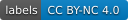

<div align="center">

# VinDr-Ground-VQA

### A Grounded Chest X-ray VQA Benchmark with an Area-Matched Occlusion Control

*Does a medical vision–language model actually **use** the radiologist-marked evidence when it answers —<br>or the text prior, or whatever else happens to be on the film?*

[](CITATION.cff)
[](data/README_DOWNLOAD.md)
[](LICENSE)
[](LICENSE)
[](eval/requirements.txt)
[](results/leaderboard.csv)


<sub>Evidence-specific reliance (excess over an area-matched random control) grows with the size of the evidence region and is near zero for small findings — in every model, from 4B to 32B. Medians with 95% paired-bootstrap CIs, n = 1,000 positives per model.</sub>

</div>

---

## 🔭 VinDr-Ground-VQA at a glance

1. **A benchmark where the image is necessary.** 102,072 questions on 8,434 VinDr-CXR radiographs and 22 findings. Every positive carries a **lesion-level radiologist consensus box** (median 1.3% of the image — 18× tighter than organ-scale grounded sets), and every "Yes" has a matched, image-necessary "No": **blind accuracy of every tested model is 0.49–0.50.**
2. **An instrument, not just a score.** Mask the evidence box, mask a **size-matched random region that avoids every annotated finding**, and take the difference. On organ-scale boxes the raw occlusion effect is *not* evidence-specific; the area-matched control is what makes grounding measurable — and it survives a full control ladder (placement, texture, lung-field, mirror, four fills, k placements).
3. **A diagnosis.** Only **13–22%** of a model's image-driven belief comes from the annotated evidence (0–8% on small findings); **correlated context substitutes for direct evidence** (3–5× collapse with detection unchanged); and the medically tuned models carry the largest **co-occurrence false-positive increment** at every scale tested.

<p align="center"></p>

## 📰 News
- **2026-11** · v1.0 public release — labels, regeneration scripts, evaluation harness with the full control ladder, reference results for nine models.
- **2026-10** · Paper accepted at **ML4H 2026**.

## 📦 Resources

| | | |
|---|---|---|
| 📄 **Paper** | ML4H 2026 | `CITATION.cff` · camera-ready errata in `docs/ERRATA_camera_ready.md` |
| 🗂️ **Labels** (102,072 QA + hard sets) | Zenodo — DOI pending | `bash scripts/fetch_data.sh <record_id>` · schema in `data/SCHEMA.md` |
| 🖼️ **Images** | PhysioNet (credentialed) | not redistributed — regenerate with `scripts/prepare_images.py` |
| 🧪 **Evaluation harness** | this repo | `eval/` — one command per model: `bash eval/run_benchmark.sh <model> <gpu>` |
| 📊 **Reference results** | this repo | `results/leaderboard.csv` · `results/ci_tables.json` · 80 per-model result files |
| 📝 **Datasheet** | this repo | `DATASHEET.md` |

## 📊 Results

<table align="center"><tr>
<td width="50%"></td>
<td width="50%"></td>
</tr><tr>
<td><sub><b>Grounding fraction</b> = excess / image-gain over cases where the image moves the model (> 0.5 nats): 0 for a blind reader, 1 when all image-driven belief lives in the evidence region.</sub></td>
<td><sub><b>Co-occurrence shortcut</b>: the false-positive increment of correlated over unrelated context rises with association strength for every medically tuned model and stays ≈ 0 for the general ones.</sub></td>
</tr></table>

**Leaderboard** — release test split, medians (margins are quantized in 0.125-nat steps); full CIs in `results/ci_tables.json`.

| model | balanced acc. | excess small / medium / large | GF (image-dependent cases) | context-FPR increment |
|---|---|---|---|---|
| MedGemma-4b-it | 0.723 | +0.19 / +0.62 / +2.50 | 0.18 | +0.157 |
| Lingshu-7B | **0.861** | +0.12 / +0.25 / +0.88 | 0.20 | +0.157 |
| InternVL3.5-8B | 0.689 | +0.00 / +0.12 / +0.75 | 0.22 | +0.010 |
| Qwen3-VL-8B-Instruct | 0.654 | +0.00 / +0.12 / +1.75 | 0.13 | +0.041 |
| MedGemma-27B-it | — | +0.12 / +0.31 / +1.50 | 0.51 (29% image-dependent) | +0.164 |
| Lingshu-32B | — | +0.12 / +0.12 / +1.00 | 0.29 (42%) | +0.149 |
| Qwen3-VL-30B-A3B | — | +0.00 / +0.38 / +1.38 | 0.14 | +0.091 |
| Gemma-3-4b-it (MedGemma's base) | 0.513 | −0.12 / +0.00 / +0.62 | — | +0.120 (near-ceiling FPR) |
| Qwen2.5-VL-7B (Lingshu's base) | 0.533 | −0.00 / +0.12 / +0.38 | — | +0.068 |

<details>
<summary><b>More tables (click to expand)</b></summary>

- `results/fills_and_controls_tables.md` — excess under mean / blur / black / inpainting fills, and under seven control-placement rules (uniform random, body-restricted, intensity-, texture-, location-matched, strict lung field, contralateral mirror)
- `results/threshold_table_sec5.4_5.5.md` — §5.4 / §5.5 under alternative co-occurrence thresholds, nine models × four association levels
- `results/k1_vs_k5.md` — one control placement vs the mean of five (tertile medians unchanged)
- `results/all_tables.md` — base-model pairs, grounding fraction for seven models, scale table, GEMeX text-shortcut check
</details>

## 🚀 Quick start

```bash
pip install -r eval/requirements.txt
# 0. label files (Zenodo) -> data/                       see data/README_DOWNLOAD.md
bash scripts/fetch_data.sh <zenodo_record_id>
# 1. images — PhysioNet credentials in ~/.netrc, or --dicom_dir pointing at your local DICOMs
python scripts/prepare_images.py --labels data/train.jsonl data/val.jsonl data/test.jsonl \
       data/hardset_v1.jsonl data/hardset_unrelated_v1.jsonl --out data/images --jobs 8
# 2. one model, every main table (≈1–2 h on one 80 GB GPU for an 8B model)
bash eval/run_benchmark.sh medgemma 0
python eval/analysis/summarize_model.py --model medgemma --append results/leaderboard_mine.csv
```

Any model loadable with `transformers.AutoModelForImageTextToText` works — add a key to `MODELS` in
`eval/mjsd_harness.py` or set `VGV_MODEL_<KEY>` to a local path. The harness needs the first-token
distribution, so closed APIs are not supported.

## 🧠 How a model is scored

For a positive question with evidence box R, three forwards give the yes/no log-odds margin on the full image
(`m_full`), with R mean-filled (`m_roi`), and with a size-matched random region that avoids every annotated
finding (`m_rand`); a text-only forward gives `m_blind`.

| quantity | definition | reads as |
|---|---|---|
| **excess** | (m_full − m_roi) − (m_full − m_rand) | evidence-specific effect, by ROI-size tertile |
| **grounding fraction GF** | excess / (m_full − m_blind), over cases with image-gain > 0.5 nats | share of image-driven belief that lives in the evidence region (0 blind … 1 ceiling) |
| **context-FPR increment** | FPR on correlated hard negatives − FPR on unrelated-context negatives | co-occurrence shortcut |
| **balanced / blind accuracy** | matched yes/no set, with and without the image | ability, and the text-shortcut check |

A model is reported as (accuracy, excess/GF by tertile, context increment) and compared on grounding at matched
accuracy. Protocol details — prompt forms, fills, placement rules, seeds, one control placement per case (five in
the resize experiment), bootstrap convention — are in `docs/protocol_appendix.md`.

## 🧰 What's in the repository

```
VinDr-Ground-VQA/
├── data/        SCHEMA.md · cooccurrence_lift.csv · dims.json · README_DOWNLOAD.md   (label files: Zenodo)
├── scripts/     prepare_images.py (DICOM → PNG, exactly our preprocessing) · build_*.py (full regeneration) · REGENERATE.md
├── eval/        mjsd_harness.py (core instrument) · accuracy_gate.py · hardset_eval.py · unrelated_eval.py ·
│                specificity_eval.py · resize_eval.py · grounding_fraction.py · occlusion_maps.py · gemex_blind.py ·
│                controls/ (placement rules · fills · inpainting · mirror & k-sensitivity · location/texture/ring ·
│                lung-field · normal-border · k1-vs-k5) · analysis/ (bootstrap CIs · threshold tables · summaries)
├── results/     leaderboard.csv · ci_tables.json · reference/ (80 per-model result files) · tables (.md)
└── docs/        protocol appendix · GEMeX protocol note · camera-ready errata · figures
```

Each script in `eval/controls/` reuses the cached release run and adds one or two forwards per case;
`eval/analysis/ci_and_reslices.py` produces every CI in the paper and `threshold_table.py` the lift-cutoff
sensitivity of §5.4–5.5.

## ⚠️ Data access, language-model fields and responsible use

- **Images are not redistributed.** VinDr-CXR is distributed by PhysioNet under a credentialed Data Use
  Agreement; this repository and the Zenodo record contain only what we built on top of it. With credentialed
  access, `scripts/prepare_images.py` regenerates the exact PNGs (deterministic preprocessing, so the boxes line up).
- **Language-model fields.** `question` paraphrases, `answer_nl` and `roi_appropriate`/`roi_reason` were produced
  by Anthropic `claude-fable-5` (August 2026) and are marked per row in `enhancements`. The deterministic core —
  `question_template`, `answer`, `roi_box`, splits, hard sets — needs no API and is what every number above uses,
  except the §5.3 stratification by `roi_appropriate`. See `DATASHEET.md`.
- **Not a clinical tool.** The benchmark measures whether models use marked evidence; it is not validated for, and
  must not be used in, clinical decision making.

## 📝 Citation

```bibtex
@inproceedings{wang2026vindrground,
  title     = {VinDr-Ground-VQA: A Grounded Chest X-ray VQA Benchmark with an Area-Matched Occlusion Control},
  author    = {Wang, Yifan and others},
  booktitle = {Proceedings of the 6th Machine Learning for Health (ML4H) Symposium},
  year      = {2026}
}
```
Please also cite VinDr-CXR (Nguyen et al., *Scientific Data*, 2022) and PhysioNet. Machine-readable metadata: `CITATION.cff`.

## 🙏 Acknowledgements

Built on [VinDr-CXR](https://physionet.org/content/vindr-cxr/1.0.0/) (Nguyen et al., 2022), distributed by
PhysioNet. Lung masks for the lung-field control from [torchxrayvision](https://github.com/mlmed/torchxrayvision).
Models evaluated: MedGemma, Lingshu, InternVL3.5, Qwen3-VL, Qwen2.5-VL, Gemma 3.

## 📄 License

Code: MIT. Labels, derived annotations and results: CC BY-NC 4.0. Images: not included — the PhysioNet
Credentialed Health Data License applies. See `LICENSE`.
