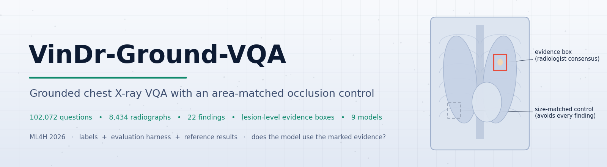
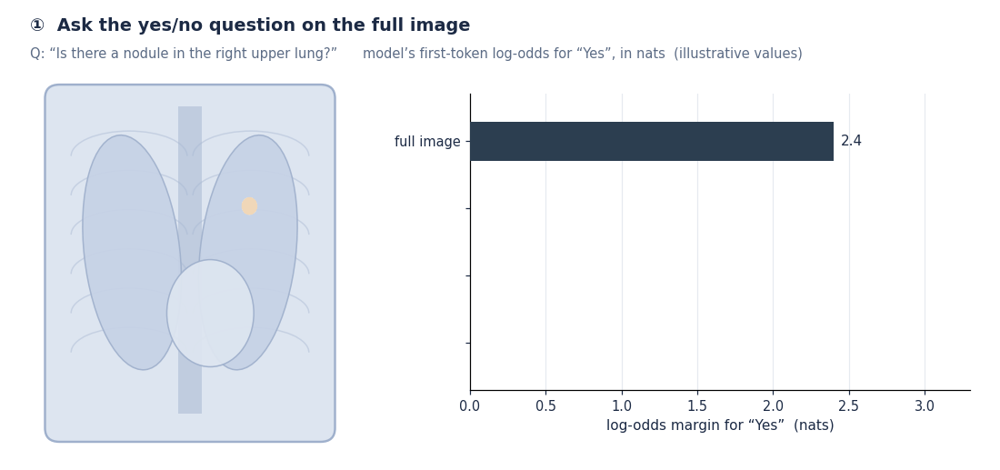
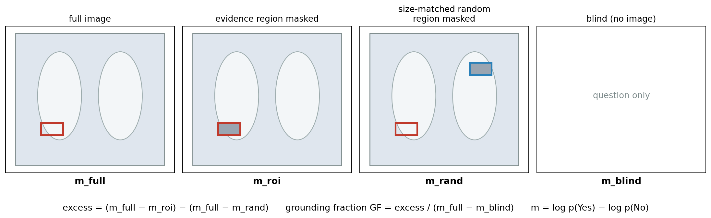
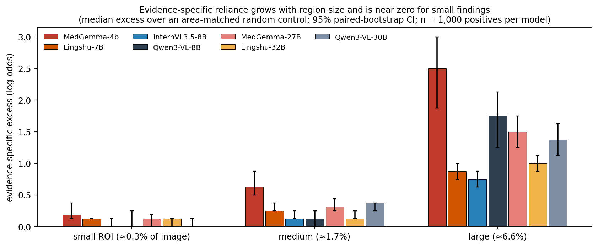
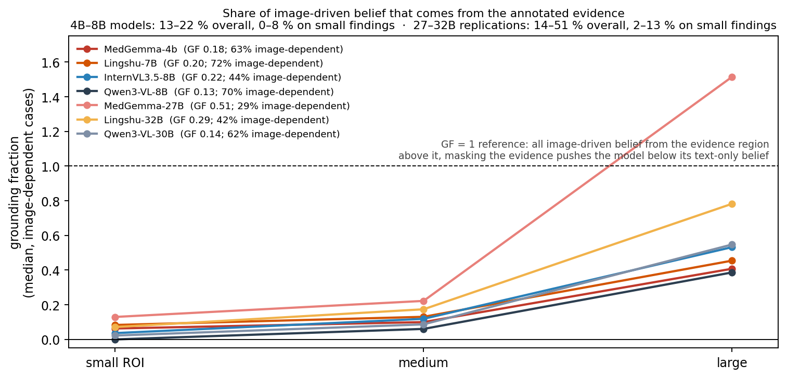
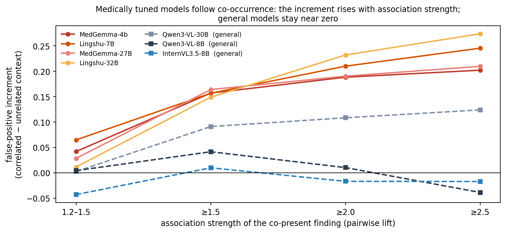

<a name="top"></a>
<div align="center">

<picture>
  <source media="(prefers-color-scheme: dark)" srcset="docs/figures/banner_dark.png">
  
</picture>

<br>

*Does a medical vision–language model actually **use** the radiologist-marked evidence when it answers —<br>or the text prior, or whatever else happens to be on the film?*

<p>
<a href="#paper"></a>
<a href="https://doi.org/10.5281/zenodo.24073784"></a>
<a href="LICENSE"></a>
<a href="eval/requirements.txt"></a>
<a href="#leaderboard"></a>
</p>
<p>


</p>

<p>
<a href="#paper"><b>📄 Paper</b></a> &nbsp;·&nbsp;
<a href="#protocol"><b>🎬 Protocol</b></a> &nbsp;·&nbsp;
<a href="#results"><b>📈 Results</b></a> &nbsp;·&nbsp;
<a href="#leaderboard"><b>🏆 Leaderboard</b></a> &nbsp;·&nbsp;
<a href="#data"><b>🗂️ Data</b></a> &nbsp;·&nbsp;
<a href="#quickstart"><b>🚀 Quick start</b></a> &nbsp;·&nbsp;
<a href="#scoring"><b>🧠 Scoring</b></a> &nbsp;·&nbsp;
<a href="#cite"><b>📝 Cite</b></a>
</p>

</div>

> [!TIP]
> **TL;DR** — VinDr-Ground-VQA pairs every positive chest-X-ray question with a **lesion-level radiologist box** and an **image-necessary matched negative**, then measures grounding as the occlusion effect of that box **in excess of a size-matched random region**. Across nine models from 4B to 32B:
> - 🎯 in the four 4B–8B models only **13–22 %** of image-driven belief comes from the annotated evidence (**0–8 %** on small findings); the 27–32B replications reach 14–51 % overall but still only **2–13 %** on small findings;
> - 🧩 **correlated context substitutes for direct evidence** — the evidence effect collapses 3–5× while detection is unchanged;
> - 🩺 the **medically tuned** models carry the largest co-occurrence false-positive increment at every scale tested.

## ✨ Highlights

<table align="center">
<tr>
<td width="33%" valign="top">

### 🗂️ A benchmark where the image is necessary
**102,072** questions on **8,434** VinDr-CXR radiographs and **22** findings. Every positive carries a lesion-level radiologist **consensus box** — median **1.3 %** of the image, ~18× tighter than organ-scale grounded sets — and every "Yes" has a matched, image-necessary "No": **blind accuracy of every tested model is 0.49–0.50.**

</td>
<td width="33%" valign="top">

### 🔬 An instrument, not just a score
Mask the evidence box, mask a **size-matched random region that avoids every annotated finding**, and take the difference. On organ-scale boxes the raw occlusion effect is *not* evidence-specific; the area-matched control is what makes grounding measurable — and it survives a full control ladder (placement, texture, lung field, mirror, four fills, *k* placements).

</td>
<td width="33%" valign="top">

### 🩻 A diagnosis of today's models
Grounding is **budget-stable but weak**, context substitutes for evidence, and medical fine-tuning buys accuracy without buying grounding. Every number is reproducible from the released labels with one command per model, and the reference results for **nine** models ship with the repo.

</td>
</tr>
</table>

<a name="protocol"></a>
## 🎬 The protocol in 20 seconds

<p align="center"></p>

<details>
<summary><b>Static version of the protocol figure</b></summary>
<p align="center"></p>
</details>

<a name="results"></a>
## 📈 Headline results

<p align="center"></p>
<p align="center"><sub>Evidence-specific reliance (excess over an area-matched random control) grows with the size of the evidence region and is near zero for small findings — in every model, from 4B to 32B. Medians with 95 % paired-bootstrap CIs, n = 1,000 positives per model.</sub></p>

<table align="center"><tr>
<td width="50%"></td>
<td width="50%"></td>
</tr><tr>
<td><sub><b>Grounding fraction</b> = excess / image-gain over cases where the image moves the model (> 0.5 nats): 0 for a blind reader, 1 when all image-driven belief lives in the evidence region. The dashed line at 1 is a reference, not a hard limit: values above it (large boxes, most visibly MedGemma-27B) mean that masking the evidence pushes the model <i>below</i> its text-only belief — the grey patch acts as counter-evidence rather than as image removal — so on large boxes GF reads as evidence-mask sensitivity relative to image gain.</sub></td>
<td><sub><b>Co-occurrence shortcut</b>: the false-positive increment of correlated over unrelated context rises with association strength for every medically tuned model and stays ≈ 0 for the general ones.</sub></td>
</tr></table>

<a name="leaderboard"></a>
## 🏆 Leaderboard

Release test split, medians (margins are quantized in 0.125-nat steps); full CIs in `results/ci_tables.json`.
**Higher is better** for accuracy and grounding fraction, **lower is better** for the context-FPR increment — and the two do not move together.

| model | balanced acc. | excess small / medium / large | grounding fraction (image-dependent cases) | context-FPR increment |
|---|:---:|:---:|:---|:---:|
| 🩺 MedGemma-4b-it | 0.723 | +0.19 / +0.62 / +2.50 | `██░░░░░░░░` 0.18 | +0.157 |
| 🩺 Lingshu-7B | **0.861** | +0.12 / +0.25 / +0.88 | `██░░░░░░░░` 0.20 | +0.157 |
| 🌐 InternVL3.5-8B | 0.689 | +0.00 / +0.12 / +0.75 | `██░░░░░░░░` 0.22 | **+0.010** |
| 🌐 Qwen3-VL-8B-Instruct | 0.654 | +0.00 / +0.12 / +1.75 | `█░░░░░░░░░` 0.13 | +0.041 |
| 🩺 MedGemma-27B-it | — | +0.12 / +0.31 / +1.50 | `█████░░░░░` **0.51** (29 % image-dependent) | +0.164 |
| 🩺 Lingshu-32B | — | +0.12 / +0.12 / +1.00 | `███░░░░░░░` 0.29 (42 %) | +0.149 |
| 🌐 Qwen3-VL-30B-A3B | — | +0.00 / +0.38 / +1.38 | `█░░░░░░░░░` 0.14 | +0.091 |
| 🧱 Gemma-3-4b-it (MedGemma's base) | 0.513 | −0.12 / +0.00 / +0.62 | — | +0.120 (near-ceiling FPR) |
| 🧱 Qwen2.5-VL-7B (Lingshu's base) | 0.533 | −0.00 / +0.12 / +0.38 | — | +0.068 |

<sub>🩺 medically tuned · 🌐 general-purpose · 🧱 base model of a medical fine-tune</sub>

<details>
<summary><b>More tables (click to expand)</b></summary>

- `results/fills_and_controls_tables.md` — excess under mean / blur / black / inpainting fills, and under seven control-placement rules (uniform random, body-restricted, intensity-, texture-, location-matched, strict lung field, contralateral mirror)
- `results/threshold_table_sec5.4_5.5.md` — §5.4 / §5.5 under alternative co-occurrence thresholds, nine models × four association levels
- `results/k1_vs_k5.md` — one control placement vs the mean of five (tertile medians unchanged)
- `results/all_tables.md` — base-model pairs, grounding fraction for seven models, scale table, GEMeX text-shortcut check
</details>

## 📰 News

- **2026-11** · 🗂️ Label archive published on Zenodo: [10.5281/zenodo.24073784](https://doi.org/10.5281/zenodo.24073784).
- **2026-11** · 🎉 v1.0 public release — labels, regeneration scripts, evaluation harness with the full control ladder, reference results for nine models.
- **2026-10** · 📄 Paper accepted at **ML4H 2026**.

<a name="data"></a>
## 📦 Resources & data access

| | what | where |
|---|---|---|
| 📄 | **Paper** (ML4H 2026) | [`CITATION.cff`](CITATION.cff) · camera-ready errata in [`docs/ERRATA_camera_ready.md`](docs/ERRATA_camera_ready.md) |
| 🗂️ | **Labels** — 102,072 QA + hard sets | Zenodo [`10.5281/zenodo.24073784`](https://doi.org/10.5281/zenodo.24073784) · `bash scripts/fetch_data.sh` · schema in [`data/SCHEMA.md`](data/SCHEMA.md) |
| 🖼️ | **Images** | PhysioNet (credentialed) — not redistributed; regenerate with [`scripts/prepare_images.py`](scripts/prepare_images.py) |
| 🧪 | **Evaluation harness** | [`eval/`](eval) — one command per model: `bash eval/run_benchmark.sh <model> <gpu>` |
| 📊 | **Reference results** | [`results/leaderboard.csv`](results/leaderboard.csv) · [`results/ci_tables.json`](results/ci_tables.json) · 80 per-model result files in [`results/reference/`](results/reference) |
| 📝 | **Datasheet** | [`DATASHEET.md`](DATASHEET.md) |

> [!IMPORTANT]
> **Images are not redistributed.** VinDr-CXR is distributed by PhysioNet under a credentialed Data Use Agreement; this repository and the Zenodo record contain only what we built on top of it. With credentialed access, `scripts/prepare_images.py` regenerates the exact PNGs (deterministic preprocessing, so the boxes line up).

<a name="quickstart"></a>
## 🚀 Quick start

```bash
pip install -r eval/requirements.txt
# 0. label files from Zenodo (10.5281/zenodo.24073784) -> data/, SHA-256 verified
bash scripts/fetch_data.sh
# 1. images — PhysioNet credentials in ~/.netrc, or --dicom_dir pointing at your local DICOMs
python scripts/prepare_images.py --labels data/train.jsonl data/val.jsonl data/test.jsonl \
       data/hardset_v1.jsonl data/hardset_unrelated_v1.jsonl --out data/images --jobs 8
# 2. one model, every main table (≈1–2 h on one 80 GB GPU for an 8B model)
bash eval/run_benchmark.sh medgemma 0
python eval/analysis/summarize_model.py --model medgemma --append results/leaderboard_mine.csv
```

Any model loadable with `transformers.AutoModelForImageTextToText` works — add a key to `MODELS` in
`eval/mjsd_harness.py` or set `VGV_MODEL_<KEY>` to a local path. The harness needs the first-token
distribution, so closed APIs are not supported.

<details>
<summary><b>Evaluating your own model — what you get back</b></summary>

`summarize_model.py` appends one leaderboard row (balanced / blind accuracy, excess by tertile, grounding fraction, context-FPR increment) and writes the per-case files that `eval/analysis/ci_and_reslices.py` turns into bootstrap CIs. The control ladder in `eval/controls/` reuses the cached release run and adds one or two forwards per case, so robustness checks cost minutes, not hours.
</details>

<a name="scoring"></a>
## 🧠 How a model is scored

For a positive question with evidence box R, three forwards give the yes/no log-odds margin on the full image
(`m_full`), with R mean-filled (`m_roi`), and with a size-matched random region that avoids every annotated
finding (`m_rand`); a text-only forward gives `m_blind`.

| quantity | definition | reads as |
|---|---|---|
| **excess** | (m_full − m_roi) − (m_full − m_rand) | evidence-specific effect, by ROI-size tertile |
| **grounding fraction GF** | excess / (m_full − m_blind), over cases with image-gain > 0.5 nats | share of image-driven belief that lives in the evidence region (0 blind … 1 reference ceiling; > 1 when the evidence mask drives the margin below the text-only margin) |
| **context-FPR increment** | FPR on correlated hard negatives − FPR on unrelated-context negatives | co-occurrence shortcut |
| **balanced / blind accuracy** | matched yes/no set, with and without the image | ability, and the text-shortcut check |

A model is reported as (accuracy, excess/GF by tertile, context increment) and compared on grounding at matched
accuracy. Protocol details — prompt forms, fills, placement rules, seeds, one control placement per case (five in
the resize experiment), bootstrap convention — are in [`docs/protocol_appendix.md`](docs/protocol_appendix.md).

## 🧰 What's in the repository

```
VinDr-Ground-VQA/
├── data/        SCHEMA.md · cooccurrence_lift.csv · dims.json · README_DOWNLOAD.md   (label files: Zenodo)
├── scripts/     prepare_images.py (DICOM → PNG, exactly our preprocessing) · build_*.py (full regeneration) · REGENERATE.md
├── eval/        mjsd_harness.py (core instrument) · accuracy_gate.py · hardset_eval.py · unrelated_eval.py ·
│                specificity_eval.py · resize_eval.py · grounding_fraction.py · occlusion_maps.py · gemex_blind.py ·
│                controls/ (placement rules · fills · inpainting · mirror & k-sensitivity · location/texture/ring ·
│                lung-field · normal-border · k1-vs-k5) · analysis/ (bootstrap CIs · threshold tables · summaries)
├── results/     leaderboard.csv · ci_tables.json · reference/ (80 per-model result files) · tables (.md)
└── docs/        protocol appendix · GEMeX protocol note · camera-ready errata · figures & badges
```

Each script in `eval/controls/` reuses the cached release run and adds one or two forwards per case;
`eval/analysis/ci_and_reslices.py` produces every CI in the paper and `threshold_table.py` the lift-cutoff
sensitivity of §5.4–5.5. All README figures are drawn from the result files (`scripts/make_readme_assets.py`) and contain no radiograph pixels.

## ⚠️ Language-model fields and responsible use

> [!NOTE]
> **Language-model fields.** `question` paraphrases, `answer_nl` and `roi_appropriate`/`roi_reason` were produced by Anthropic `claude-fable-5` (August 2026) and are marked per row in `enhancements`. The deterministic core — `question_template`, `answer`, `roi_box`, splits, hard sets — needs no API and is what every number above uses, except the §5.3 stratification by `roi_appropriate`. See [`DATASHEET.md`](DATASHEET.md).

> [!CAUTION]
> **Not a clinical tool.** The benchmark measures whether models use marked evidence; it is not validated for, and must not be used in, clinical decision making.

<a name="paper"></a>
<a name="cite"></a>
## 📝 Citation

```bibtex
@inproceedings{wang2026vindrground,
  title     = {VinDr-Ground-VQA: A Grounded Chest X-ray VQA Benchmark with an Area-Matched Occlusion Control},
  author    = {Wang, Yifan and Wu, Yutong},
  booktitle = {Proceedings of the 6th Machine Learning for Health (ML4H) Symposium},
  year      = {2026}
}
```
Label archive: Wang, Y. & Wu, Y. (2026). *VinDr-Ground-VQA: labels for a grounded, image-necessary chest X-ray VQA benchmark (v1.0)* [Data set]. Zenodo. https://doi.org/10.5281/zenodo.24073784

Please also cite VinDr-CXR (Nguyen et al., *Scientific Data*, 2022) and PhysioNet. Machine-readable metadata: [`CITATION.cff`](CITATION.cff).

## 🙏 Acknowledgements

Built on [VinDr-CXR](https://physionet.org/content/vindr-cxr/1.0.0/) (Nguyen et al., 2022), distributed by
PhysioNet. Lung masks for the lung-field control from [torchxrayvision](https://github.com/mlmed/torchxrayvision).
Models evaluated: MedGemma, Lingshu, InternVL3.5, Qwen3-VL, Qwen2.5-VL, Gemma 3.

## 📄 License

Everything in this repository and in the Zenodo label archive — code, labels, derived annotations, results and
documentation — is released under the [MIT License](LICENSE). Images are not included: VinDr-CXR images remain
under the PhysioNet Credentialed Health Data License 1.5.0 and its Data Use Agreement, and nothing here grants
any right to them.

<div align="center">
<br>
<sub>If VinDr-Ground-VQA is useful in your work, a ⭐ on the repository helps others find it.</sub>
<br><br>
<a href="#top">⬆ back to top</a>
</div>
